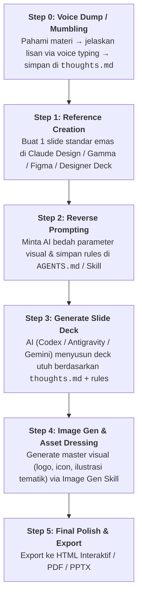

# 📊 Reverse Prompting Slide Workflow (Metode @levifikri)

Panduan komprehensif pembuatan slide presentasi kelas profesional (*high-end deck*) menggunakan sinergi **Cognitive Voice Dumping (`thoughts.md`)**, **Reverse Prompting (Design Decision Extraction)**, dan **Multi-Agent Asset Generation (Image Gen)**.

---

## 💡 1. Filosofi & Landasan Teori

### A. *"Don't Outsource Your Understanding"*
> **"You can outsource your thinking, but you cannot outsource your understanding."** — *@yacineMTB*  
> **"Bentuk tertinggi dari memahami sesuatu adalah ketika kita bisa mengajarkannya."** — *@levifikri*

* **Masalah AI Biasa:** Menyuruh AI merangkum materi mentah dari web menghasilkan slide klise, generik, dan tanpa jiwa.
* **Pendekatan Kognitif:** Baca dan pahami materinya terlebih dahulu, lalu ceritakan kembali menggunakan bahasa sendiri via **voice input (mumbling / speaking bebas)**. 
* **Toleransi Bahasa Mumbling:** Dalam proses *speaking*, bahasa tidak harus rapi. Kalimat berbelit, repetitif, atau diselingi *"hmmm, oh, eh"* adalah hal wajar. AI modern berfungsi sebagai **Any-to-Any Transformer** yang mampu mengubah celoteh mentah menjadi struktur logis yang teratur.
* **Krusial — Berikan Outline / Story Arc:** AI harus dipandu garis besar urutan pembahasannya agar slide tetap terarah dan memiliki tensi presentasi yang kuat (*"otherwise gak terlalu terarah jadinya"*).

### B. Mengapa Reverse Prompting Berhasil?
> **"Reverse prompting works because the reference slide carries design decisions the model would otherwise have to infer."** — *@jurlycat*

* **Landscape Tool:** Model LLM general-purpose (Codex, Gemini, Kimi biasa) secara bawaan masih tertinggal dibanding alat terdedikasi seperti **Claude Design** atau **Gamma**. Mengapa? Karena pada *blank canvas*, model harus menebak ratusan variabel desain sekaligus (skala tipografi, whitespace, ritme bento grid, kontras warna, densitas teks).
* **Solusi Reverse Prompting:** Berikan 1 contoh slide referensi visual yang bagus ke AI, minta AI membedah seluruh keputusan desainnya (*design decisions*), lalu kunci hasilnya sebagai aturan sistem di `AGENTS.md` atau skill lokal.
* **Pergeseran Peran:** *"这下拼的不是幻灯片，而是谁更会当甲方了"* (Sekarang bukan lagi adu skill bikin slide manual, tapi adu lihai menjadi *creative director* / pengarah AI).

---

## 🔄 2. The 5-Step Execution Pipeline



---

## 🛠️ 3. Template & Prompt Siap Pakai

### A. Template `thoughts.md` (Speech-to-Text Raw Dump)
Simpan file ini di folder kerja saat memulai proyek presentasi:

```markdown
# [Judul / Topik Presentasi]
- Target Audiens: [cth: Board of Directors / Engineers / Calon Investor]
- Alokasi Waktu / Target Slide: [cth: 15 Menit / ~8-10 Slide]
- Nada Penyampaian: [cth: Persuasif, data-driven, minimalis, tajam]

## Garis Besar Alur Pembahasan (Story Arc):
1. Context & Status Quo (Kondisi saat ini & rasa sakit pasar)
2. Why Existing Solutions Fail (Bottleneck solusi lama)
3. The Core Paradigm Shift (Ide terobosan utama)
4. Deep Dive Architecture / Solution (Cara kerja & bukti implementasi)
5. Business Metrics, Impact & Call to Action (Next steps)

## Raw Thoughts / Voice Transcript:
[Paste hasil rekaman voice typing / Whisper / dikte di sini. Ceritakan pemahaman Anda dengan bahasa sendiri, biarkan mengalir tanpa diedit...]
```

---

### B. Prompt Reverse Engineering (Ekstraksi Desain ke Rules)
Kirimkan tangkapan layar / PDF / file slide acuan terbaik (dari Claude Design, Gamma, atau desainer):

```text
Kamu adalah Principal Presentation & Visual Designer.
Pelajari slide referensi terlampir ini secara mendalam. Bedah seluruh keputusan desainnya (design decisions) yang membuatnya terlihat premium dan profesional:

1. Layout System:
   - Grid architecture (Bento grid, 2-column split, hero stat emphasis, card groups).
   - Whitespace ratio, margins, internal container padding.
2. Typography Hierarchy:
   - Font pairing (Display heading vs body vs labels).
   - Font scale, weight, line-height, letter-spacing.
   - Text density rules (maksimal kata per kartu/bullet).
3. Color & Contrast Tokens:
   - Background canvas, surface container, high-contrast text, accent highlights.
4. Component Patterns:
   - Chip badges, status pills, border strokes, metric counters, iconography style.
5. Content Rhythm:
   - Pola headline persuasif vs sub-headline vs body copy.

Rangkum hasil ekstraksi ini menjadi "Slide Design Directives" yang padat, presisi, dan terstruktur agar dapat dimasukkan ke AGENTS.md / Skill lokal untuk membuat slide deck berikutnya.
```

---

### C. Prompt Eksekusi Slide Deck + Image Generation
Setelah aturan desain siap, instruksikan AI coding agent:

```text
Baca file `thoughts.md` terlampir dan terapkan "Slide Design Directives" yang telah kita buat:
1. Susun slide deck interaktif lengkap (format self-contained HTML slide deck / Presentation).
2. Ikuti Story Arc yang sudah saya tentukan di `thoughts.md`.
3. Jaga densitas teks tetap ringkas (maksimal 2-3 baris per kartu poin, no wall of text).
4. Bertindaklah seperti "Produser Konten":
   - Tentukan kebutuhan visual untuk setiap slide (diagram, icon, ilustrasi tematik).
   - Buatkan prompt deskriptif gambar dengan style konsisten.
   - Panggil tool `generate_image` (aspek rasio 16:9 atau 1:1) dan sematkan hasilnya langsung ke masing-masing slide.
5. Sediakan tombol navigasi (Next/Prev/Keyboard arrow) dan opsi Print/Export ke PDF.
```

---

## 🎨 4. Mindset "Produser": Konsistensi Aset Lintas Slide
*(Insight dari eksperimen @AI_AriefIbrahim & komunitas)*

Agar slide deck tidak terlihat seperti tempelan gambar acak:
1. **Master Prompt Style**: Definisikan satu formula prompt gaya gambar di awal (misal: *"Minimalist 3D isometric render, frosted glass texture, deep navy background with vibrant cyan accents, studio lighting, high resolution, clean lines"*).
2. **Karakter & Icon Konsisten**: Gunakan token style yang identik di setiap pemanggilan `generate_image` agar tone visual antar-slide harmonis.
3. **Penyematan Otomatis**: AI agent dapat mengunduh / menyematkan path gambar hasil generate langsung ke tag `` pada slide terkait.

---

## 📋 5. Ringkasan Tool Alternatif di Ekosistem Slide AI

| Tool / Model | Kelebihan | Kekurangan | Rekomendasi Penggunaan |
| :--- | :--- | :--- | :--- |
| **Claude Design** | Desain tipografi & visual sangat matang secara estetika | Tidak selalu tersedia sebagai tool standalone | Generator slide referensi (Gold Standard) untuk di-reverse prompt |
| **Gamma** | Cepat, spesifik untuk presentasi & dokumen visual | Template bisa terasa generik jika tidak dikustomisasi | Generator deck awal & referensi layout |
| **Codex / Antigravity** | Fleksibel, mampu coding HTML slide kustom + integrasi tools/image | Butuh panduan rules eksplisit agar visual tidak kaku | Builder deck utama dengan Reverse Prompting + Image Gen |
| **Kimi Slide / K3** | Terintegrasi di ekosistem Kimi | Versi free terbatas, kualitas variatif | Alternatif pembuat slide cepat |
| **Google Slides AI** | Langsung di Google Workspace | Fleksibilitas styling & layout terbatas | Presentasi internal cepat / corporate standar |

---

## ✅ Checklist Kunci Keberhasilan

- [ ] **Kognisi Otentik**: `thoughts.md` berasal dari pemahaman sendiri lewat rekaman suara, bukan copy-paste artikel web.
- [ ] **Story Arc Jelas**: Outline urutan topik sudah terkunci sebelum slide digenerate.
- [ ] **Design Decisions Terkunci**: Rules visual sudah diekstrak dari referensi premium.
- [ ] **Aset Visual Konsisten**: Gaya ilustrasi seragam menggunakan master prompt formula.
- [ ] **Interaktif & Portable**: Output slide berupa HTML interaktif atau PDF siap tayang.
